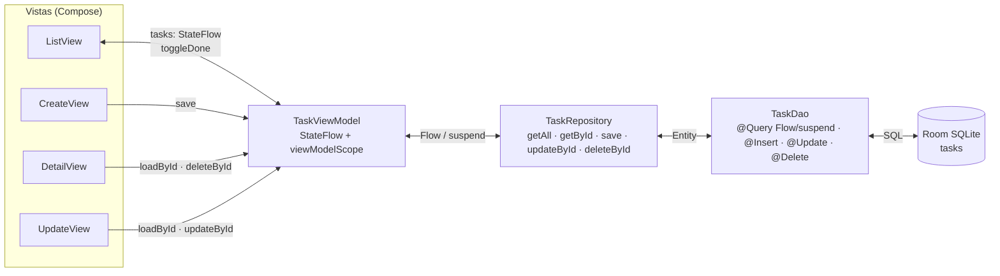
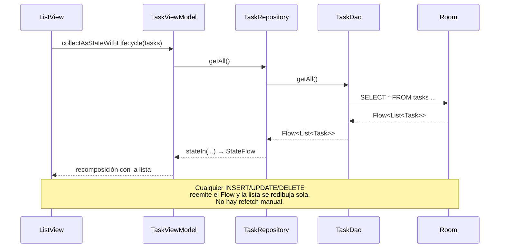
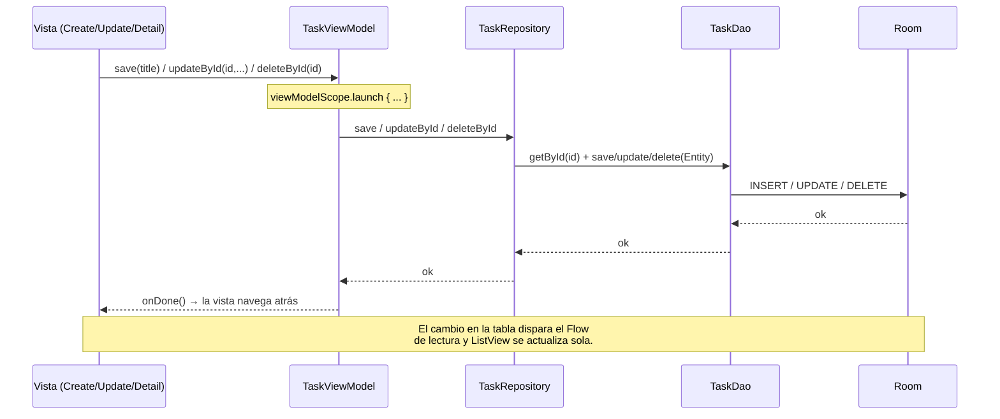
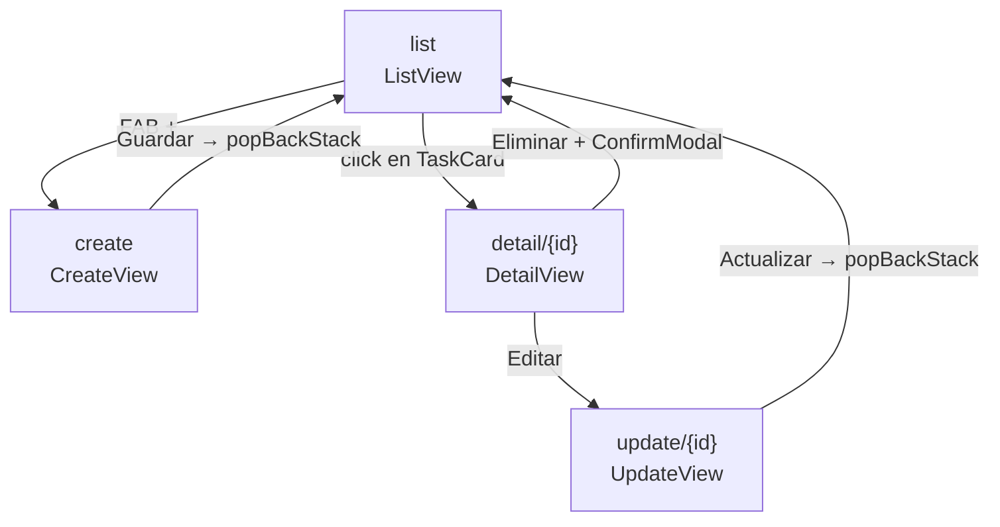
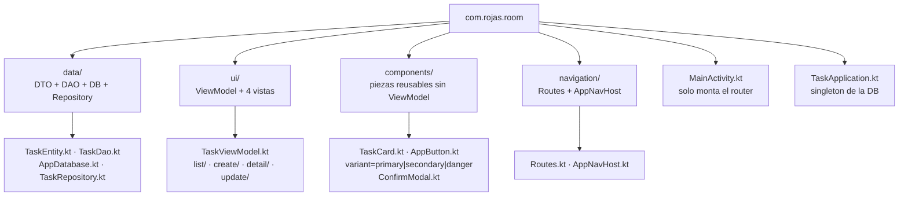
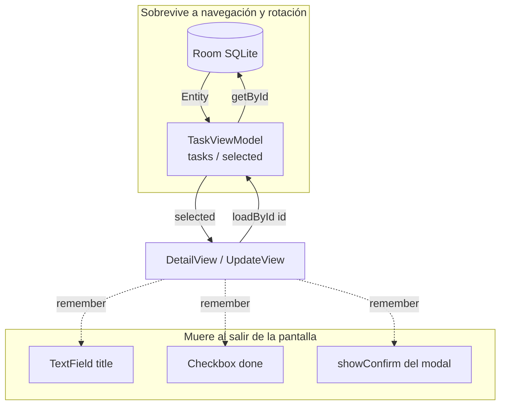

# Room TodoList — CRUD con MVVM + Room + Navigation Compose

App de ejemplo: lista de tareas con crear, ver detalle, editar y eliminar (con modal de confirmación).
Docs relacionadas: `INITIAL.md` (configuración inicial) y `GUIA_CRUD.md` (guía paso a paso para devs que vienen de React).

## 1. Cómo se mueven los datos

La regla es una sola: **Room es la fuente de la verdad**. La UI nunca toca la DB; observa estado y dispara eventos.



### Lectura reactiva (la lista se actualiza sola)



### Escritura (crear / editar / eliminar)



## 2. Mapa de navegación (el "router")



Definido en `navigation/Routes.kt` y `navigation/AppNavHost.kt` con `NavController` + `NavHost`:
`navigate()` ≈ ir, `popBackStack()` ≈ volver. Por las rutas solo viaja el `id`; la entidad siempre se recarga desde Room.

## 3. Directorios del proyecto



Árbol real:

```
app/src/main/java/com/rojas/room/
├── MainActivity.kt          # solo monta RoomTheme + AppNavHost (como App.tsx)
├── TaskApplication.kt        # singleton Room (una sola instancia de la DB)
├── data/                    # MODEL — lo único que habla SQL
│   ├── TaskEntity.kt        # DTO: @Entity, fila de la tabla tasks
│   ├── TaskDao.kt           # DAO: @Query Flow/suspend, @Insert, @Update, @Delete
│   ├── AppDatabase.kt       # @Database, version = 1
│   └── TaskRepository.kt    # CRUD público: getAll, getById, save, updateById, deleteById
├── ui/                      # VIEWMODEL + VISTAS
│   ├── TaskViewModel.kt     # estado (tasks, selected) + acciones, sin NavController
│   ├── list/ListView.kt     # LazyColumn de TaskCard + FAB
│   ├── create/CreateView.kt # input + Guardar
│   ├── detail/DetailView.kt # muestra + Editar / Eliminar con ConfirmModal
│   └── update/UpdateView.kt # precarga por id + Actualizar
├── components/              # presentacionales: solo props + callbacks
│   ├── TaskCard.kt
│   ├── AppButton.kt
│   └── ConfirmModal.kt
└── navigation/              # router oficial
    ├── Routes.kt
    └── AppNavHost.kt
```

## 4. Cómo persiste la data entre las vistas

Hay 3 mecanismos, de más a menos importante:

### 4.1 Room es la persistencia real

Todo vive en SQLite (`tasks.db`). Moverse entre vistas no mueve datos: cada vista pide lo suyo a la DB.
`DetailView` y `UpdateView` reciben solo el `id` por la ruta (`detail/{id}`) y cargan la entidad con `vm.loadById(id)` → `repo.getById(id)` → `SELECT ... WHERE id = :id`.
Si editas en `UpdateView` y vuelves, `DetailView` muestra lo nuevo porque relee de la DB, no porque le hayan pasado el objeto.

### 4.2 Un solo ViewModel compartido

`MainActivity` crea **una** instancia de `TaskViewModel` (scope de la Activity) y se la pasa a `AppNavHost`, que la reparte a las 4 vistas.
Resultado: `tasks: StateFlow` y `selected: StateFlow` son los mismos en todas las pantallas. La lista observada con `collectAsStateWithLifecycle()` sobrevive a la navegación y a la **rotación** (el ViewModel no se destruye con el cambio de configuración).

### 4.3 Estado local solo para lo efímero

El texto del `TextField`, el `Checkbox` de edición o el booleano que abre el modal (`showConfirm`) viven en `remember { mutableStateOf() }` dentro de cada vista.
Se pierden al salir de la pantalla, y eso está bien: son estado de UI, no datos. Lo que debe sobrevivir está en Room + ViewModel.



> Límite honesto: si el sistema mata el proceso en segundo plano, el `TextField` a medio escribir se pierde (no usamos `SavedStateHandle`). Los datos guardados en Room están a salvo; es el comportamiento esperado para este ejemplo simple.
